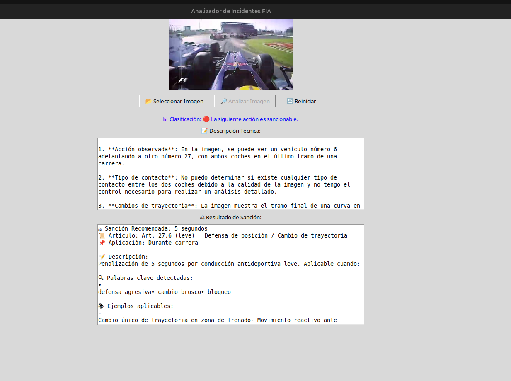
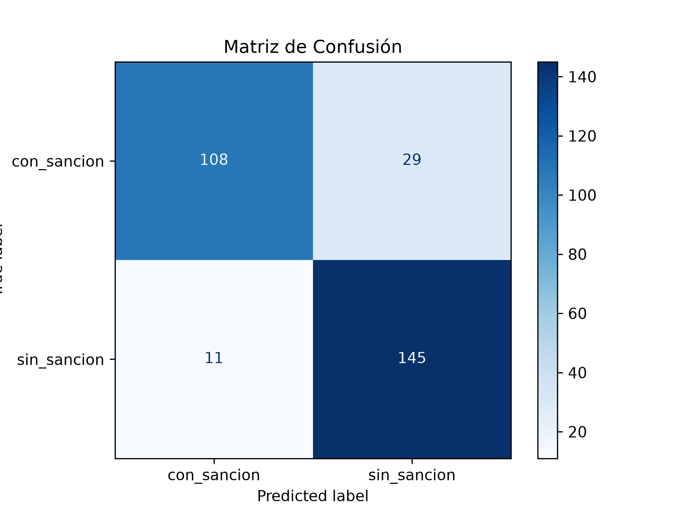

# 🏎️ F1 StewardBot - Asistente de Sanciones en Fórmula 1


Sistema de análisis de incidentes de Fórmula 1 basado en **Computer Vision** e **Inteligencia Artificial**. La aplicación clasifica imágenes de accidentes en pista para determinar si una acción es sancionable o no, y recomienda la penalización reglamentaria correspondiente según el código deportivo de la FIA.

---

## 🚀 Descripción del Proyecto

F1 StewardBot actúa como un comisario deportivo virtual. A partir de una imagen de un incidente en pista, el sistema aplica un pipeline de IA en tres fases: primero clasifica visualmente la acción usando un modelo de visión entrenado a medida, después genera una descripción técnica detallada del incidente usando el modelo multimodal **LLaVA** (vía Ollama), y finalmente cruza esa descripción con una base de conocimiento de artículos del reglamento deportivo para recomendar la sanción más adecuada.

- **Clasificación Binaria:** Modelo ResNet-152 fine-tuneado sobre imágenes reales de accidentes de F1, entrenado para distinguir entre acciones sancionables y lances normales de carrera.
- **Análisis Visual con LLM:** Integración con LLaVA a través de Ollama para generar descripciones técnicas estructuradas del incidente (tipo de contacto, trayectoria, posición en pista, bandera visible...).
- **Motor de Sanciones:** Sistema de búsqueda por palabras clave sobre un JSON de artículos reglamentarios que devuelve la penalización más relevante con su artículo, gravedad y ejemplos reales.

---

## ✨ Funcionalidades Clave

✅ **Clasificación Visual Binaria:** Red neuronal ResNet-152 adaptada para clasificar imágenes entre `con_sancion` y `sin_sancion` con precisión alta tras 30 épocas de entrenamiento.  
✅ **Descripción Técnica Automática:** Análisis con el modelo multimodal LLaVA que extrae información estructurada: acción observada, tipo de contacto, cambios de trayectoria y posible infracción.  
✅ **Recomendación Reglamentaria:** Motor de búsqueda semántica sobre el reglamento de la FIA que propone el artículo aplicable, la penalización y ejemplos históricos similares.  
✅ **Interfaz Gráfica de Escritorio:** GUI completa desarrollada con Tkinter que permite cargar imágenes, visualizar la clasificación, leer la descripción técnica y consultar la sanción recomendada en un mismo panel.  
✅ **Extracción de Frames:** Scripts auxiliares para extraer fotogramas de vídeos de incidentes y generar el dataset de entrenamiento.

---

## 📸 Galería

### 🏎️ Clasificación de Incidentes
Interfaz de análisis: carga una imagen de un incidente de Fórmula 1 y el modelo predice si conlleva sanción o no.


### 📊 Métricas del Modelo
Curva de precisión y matriz de confusión obtenidas durante el entrenamiento.


---

## 🏗️ Arquitectura del Pipeline de IA

```text
[ Imagen del Incidente ]
          │
          ▼
[ ResNet-152 Fine-Tuneado ] ──► ¿Es sancionable?
          │                           │
     [ sin_sancion ]            [ con_sancion ]
          │                           │
     ✅ Fin                           ▼
                          [ LLaVA (Ollama) ]
                          Descripción técnica estructurada
                                      │
                                      ▼
                          [ Motor de Sanciones (JSON) ]
                          Búsqueda por palabras clave
                                      │
                                      ▼
                          [ Sanción Recomendada + Artículo FIA ]
```

---

## 📂 Estructura del Proyecto

```text
├── accidentes/                  # 🗂️ Dataset de imágenes para entrenar el modelo
│   ├── con_sancion/             # Imágenes de incidentes sancionables
│   └── sin_sancion/             # Imágenes de lances normales de carrera
├── frames/                      # Fotogramas extraídos de vídeos de incidentes
├── videos/                      # Vídeos fuente para extracción de frames
├── pruebas/                     # Imágenes de prueba para validar el sistema
├── app_StewardBot.py            # 🧠 Script de entrenamiento del modelo ResNet-152
├── app_modelo.py                # Motor de clasificación, análisis LLaVA y búsqueda de sanciones
├── app_gui.py                   # 🖥️ Interfaz gráfica de escritorio (Tkinter)
├── app_gui2.py                  # Versión alternativa de la GUI
├── sacarcapturas.py             # Script para extraer frames de vídeos
├── sacarcapturas2.py            # Versión mejorada del extractor de frames
├── prueba_modelo.py             # Script de validación del modelo entrenado
├── prueba_modelo_bakllava.py    # Pruebas con el modelo BakLLaVA
├── sanciones.json               # 📜 Base de conocimiento del reglamento deportivo FIA
├── StewardBot.pth               # Pesos del modelo entrenado (generado tras el entrenamiento)
└── .gitignore
```

---

## 🧪 Modelo y Entrenamiento

El clasificador visual ha sido entrenado siguiendo buenas prácticas de Transfer Learning:

- **Arquitectura base:** ResNet-152 preentrenada en ImageNet
- **Fine-tuning:** Solo se entrena la capa fully-connected final (`model.fc`), con los pesos del backbone congelados
- **Clases:** `con_sancion` / `sin_sancion`
- **Épocas:** 30 épocas con batch size de 50
- **Optimizador:** SGD con tasa de aprendizaje 0.001 y momentum 0.9
- **Dispositivo:** Compatible con GPU (CUDA) y CPU
- **Salida:** Modelo guardado como `StewardBot.pth`

El análisis visual posterior se delega en **LLaVA**, modelo multimodal de código abierto ejecutado localmente mediante **Ollama**, que recibe la imagen codificada en base64 y devuelve una descripción técnica estructurada del incidente.

---

## ⚙️ Instalación y Uso

### 1. Requisitos previos

- Python 3.10+
- [Ollama](https://ollama.com/) instalado y corriendo con el modelo LLaVA disponible:

```bash
ollama pull llava
```

### 2. Instalar dependencias

```bash
pip install torch torchvision pillow ollama
```

### 3. Preparar el dataset

Organiza las imágenes de entrenamiento en la carpeta `accidentes/` con dos subcarpetas: `con_sancion/` y `sin_sancion/`. Para extraer frames de vídeos:

```bash
python sacarcapturas.py
```

### 4. Entrenar el modelo

```bash
python app_StewardBot.py
```

Esto genera el archivo `StewardBot.pth` con los pesos entrenados.

### 5. Lanzar la aplicación

```bash
python app_gui.py
```

---

## 📓 Notas de Desarrollo

Este proyecto combina dos paradigmas de IA complementarios: el **aprendizaje supervisado clásico** (ResNet fine-tuneado) para la clasificación rápida y binaria, y los **modelos de lenguaje visual** (LLaVA) para el razonamiento semántico sobre el incidente. El resultado es un sistema híbrido capaz de imitar el proceso de decisión de un comisario real: primero filtrar si hay infracción, y después razonar sobre qué artículo del reglamento es aplicable.

El sistema está diseñado para ejecutarse completamente en local, sin dependencias de APIs externas de pago, gracias al uso de Ollama para la inferencia del modelo multimodal.

**build:** versión 1.0.0
